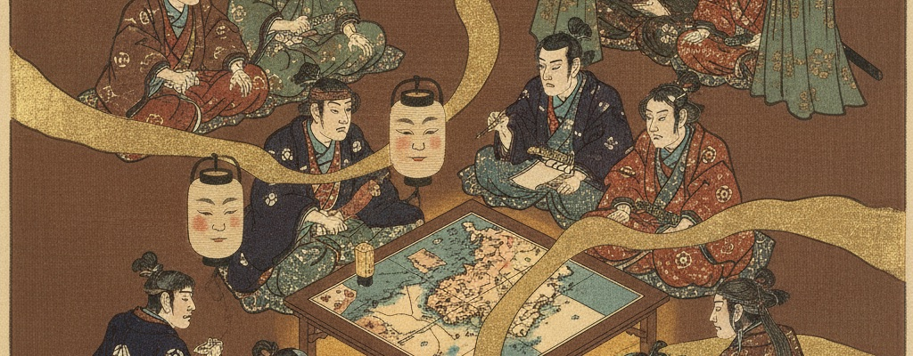

# Susumiba

**Humans and AIs. Finally coordinated.**

People and AIs, as many as you like, work on the same project. Each brings ideas and finished work with their own AI; a clerk keeps the synthesis, who did what and what is left, with every sentence pointing to its source. Feedback goes straight to the right person instead of passing from hand to hand.

Paste this into an AI that can run commands on your computer (the Claude desktop app, "Code" tab; Codex in the ChatGPT desktop app; Claude Code; Codex):

> Read https://susumiba.com/ia.md and tell me what it could do for me.

> Lis https://susumiba.com/ia.md et dis-moi ce que ça pourrait m'apporter.

- **[susumiba](https://github.com/susumiba/susumiba)**: the instructions your AI reads (`ia.md`, `setup.md`), the optional clerk Action, the tests.
- **[template](https://github.com/susumiba/template)**: what a project is made from.

Open source, MIT license. Made by Pierre Riche. [susumiba.com](https://susumiba.com)
